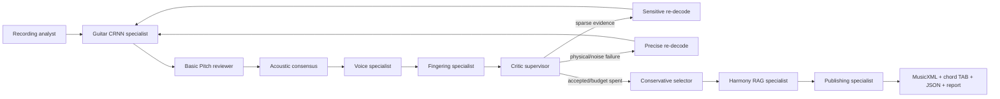

# Architecture

## Specialist-agent workflow



`fretwork_agents/state.py` defines the typed blackboard, `roles.py` owns the
specialist policies, and `workflow.py` contains only graph topology and the
runner. `fretwork_agent.py` is a compatibility facade and CLI.
The CRNN proposal and Basic Pitch review are independent acoustic artifacts;
the consensus agent reconciles them before downstream agents consume notes.
LangGraph owns supervision and conditional retry routing, while LangChain Core
`RunnableLambda` objects define each agent contract. This is local,
policy-based multi-agent execution, not an LLM role-play loop.

The audit report names every agent, its responsibility, each attempt, selected
profile, harmony labels, output artifacts, and the complete workflow log.

## Acoustic collaboration

The GAPS guitar CRNN jointly predicts temporal onset, offset, active-frame, and
velocity sequences. Its large activation lattice is cached, so threshold
re-decodes do not rerun the network. Basic Pitch independently proposes events.
Exact-pitch/onset agreements are tagged with both sources. Unsupported Basic
Pitch notes require high strength and are rejected when they resemble nearby
octave conflicts; the guitar model remains primary evidence.

Model strengths are uncalibrated. They are health signals, not probabilities
that a note is correct. A precise retry is selected only if it removes a
concrete physical/noise failure while retaining at least 72% of baseline
events. A sensitive retry must recover bounded evidence without adding a
physical failure.

## Evaluation boundary

`evaluation/gaps_test_15.json` selects fixed excerpts from the official GAPS
test split and pins the dataset revision plus source integrity values.
`evaluation/run_transcription.py` independently scores GAPS, Basic Pitch, and
the reconciled proposal with `mir_eval`. The report keeps per-clip metrics and
reviewer-decision counts, so aggregate claims can be traced to individual
recordings. Predictions are cached outside version control; model thresholds
must not be tuned against this test set.

The benchmark measures note-event transcription only. Chord labels, rhythmic
engraving, voice assignment, fingering quality, capo inference, and anime-cover
domain transfer require separate labeled evaluations.

## Harmony retrieval (local RAG)

`knowledge/chords.json` contains versioned interval, required-tone, alias,
description, and priority records. The harmony agent retrieves/ranks all
root-transposed templates against confidence-weighted pitch classes collected
over beat or half-measure windows. This lets a spread C-E-G arpeggio produce
`C` even when no notes start together. Weak/single-note windows are suppressed,
inversions and extended qualities are supported, and adjacent repeats merge.
Within each uninterrupted run, a second Viterbi pass chooses among near-best
candidates using only the preceding chord. The transition prior is deliberately
small: it resolves close evidence instead of forcing a conventional progression.

Labels are transposed down by the selected capo to describe hand shapes;
MusicXML notes stay at sounding pitch. Retrieval grounds annotation only and
cannot replace strong audio evidence.
Each label carries the retrieved corpus ID/score plus separate hand-shape and
sounding symbols, so the RAG provenance and capo transformation are auditable.

## Fretboard optimization

Each onset cluster produces its complete finite set of distinct-string shapes.
A shape uses capo-relative frets, penalizes excessive stretch, and biases bass
and upper voices toward appropriate strings. Optional rough TAB is soft
evidence.

For shape `s` in layer `i`:

```text
dp[i][s] = intra(s) + min(dp[i-1][p] + transition(p, s))
```

Transition cost depends only on the adjacent pair and includes hand-center
shift, per-string fret motion, released/added strings, and string-reuse
conflicts when the previous audio note is still ringing. Backtracking yields
the global minimum over the full trellis in `O(n·k²)`. There is no beam pruning
or center-only predecessor collapse.

An impossible cluster (more than six notes or no full mapping) is handled
outside the exact playable model: maximum-cardinality partial shapes among the
six strongest detections are enumerated, omissions are marked unassigned, and
the critic sees the failure.

## MCP boundary

`mcp_server.py` uses the official MCP Python SDK v2 and stdio transport. Tools
validate resolved local paths against allowlisted roots, run the graph, query
the chord corpus, and inspect reports. Remote URLs are rejected. Large ML
tensors stay process-local; only paths and small JSON-compatible artifacts
cross the protocol.

## Current limits

- Capo cannot be identified with certainty from audio alone.
- Global BPM, assumed 4/4, and a sixteenth grid do not fully model rubato.
- Voice separation remains heuristic rather than a trained multi-voice model.
- Standard tuning is currently assumed; alternate/drop-D needs explicit work.
- The health score is not measured pitch, rhythm, chord, or fingering accuracy.
- A human must listen and edit before treating output as a performance edition.
- Full-band anime masters require source separation and arrangement decisions.
